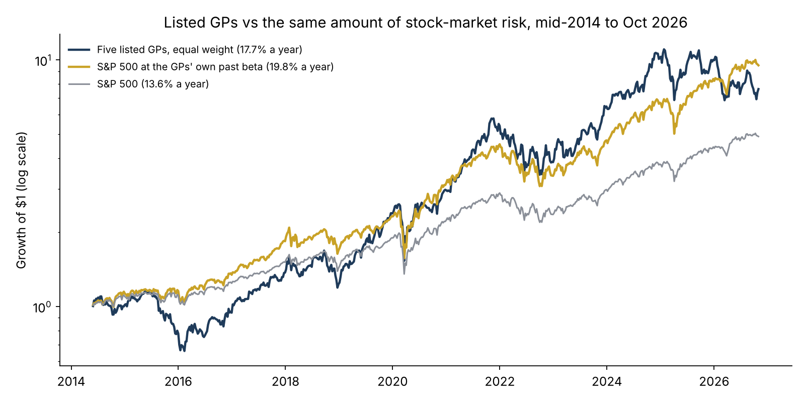

# Buying the GP: are listed private-markets firms alpha or leverage? 2012–2026

Many allocators buy shares of listed alternative asset managers (the general partners, or GPs, that run private equity and private credit funds) as a liquid way to own private markets. This project asks whether those shares earned more than the stock-market risk they carry. Weekly total returns for Blackstone (BX), KKR, Apollo (APO), Carlyle (CG) and Ares (ARES), June 2012 to 30 October 2026.

## Results

- **High return, high risk.** The equal-weight GP basket returned 22.1% a year against 14.8% for the S&P 500, with 30% volatility (vs 16%) and a −43% maximum drawdown (vs −32%).
- **It is leveraged equity plus credit.** Market beta 1.46 (R² 0.58). With high yield and rates added: equity beta 1.10, high-yield beta 0.84 (t = 7.1), no significant rate exposure; alpha 5.2% a year with t = 1.0.
- **Matched for risk, no edge.** Against the S&P 500 held at the basket's own trailing two-year beta (about 1.44, set from past data only, financed at T-bills), from May 2014 to October 2026: 17.7% a year vs 19.8%. The average excess was +0.4% a year (t = 0.07; block-bootstrap 95% interval −10.7% to +11.0%) with 20% tracking error. The extra volatility cost about 2 points a year of compounding. The pre-registered hypothesis (no excess after matching beta) is not rejected.
- **Lumpy, firm-specific.** The gap comes from a few years: +56 points in 2019, +35 in 2021, +29 in 2023, −27 in 2025 and −38 in 2026 to October. By firm, ARES beat its matched S&P (28.2% vs 22.0% a year) and CG trailed it (7.5% vs 19.2%).



## The commercial case

| Element | What it is |
|---|---|
| Who pays | OCIOs, wealth platforms and multi-asset funds that hold GP stocks, BDCs or listed infrastructure as a "liquid alternatives" sleeve |
| The problem | The sleeve is booked as diversification but carries 1.4–1.7x equity beta plus credit beta |
| The product | A look-through risk report for listed alternatives: equity, credit and rate betas, beta-matched excess return and drawdown, quarterly |
| Proof | 14 years of weekly data; beta set from past data only; bootstrap and robustness checks |
| Build vs buy | 2–3 weeks on public data; most platforms classify by label today |
| Pricing logic | $25–40k a year per platform (illustrative): $100m in the basket carried the equity risk of about $144m of S&P 500 |
| Adoption risk | The sleeve's label is sticky; the KPI is realised drawdown vs the risk budget |

## Method

1. Daily split-adjusted closes and dividends → weekly total returns; equal-weight basket of the names listed that week (ARES from 2014).
2. Regressions of weekly excess return on S&P 500 excess return, high-yield (JNK) excess return and the 10-year yield change; Newey-West (4 lags) t-statistics.
3. Beta-matched benchmark fixed in advance: SPY position = trailing 104-week beta, shifted one week, financed at 3-month T-bills, 5 bp on changes in the SPY position.
4. Excess return, tracking error, 26-week block bootstrap (2,000 draws); split 2014–2019 vs 2020–2026; 52- and 156-week betas; 20 bp costs; each firm alone.

## Run it

```
pip install -r requirements.txt
make ingest   # downloads the three public files and checks sha256
make run      # reports/metrics.json and reports/figures/*.png
make test
```

## Limits

- Five survivors and winners of the industry's growth; firms that did not list or did not last are missing.
- Fourteen years is short for a 20%-volatility excess return: the bootstrap interval is ±11 points a year.
- Share prices reflect index inclusion and corporate conversions (several firms converted from partnerships to corporations in 2019), not only private-markets performance.
- Independent research on public data; not deployed; not investment advice.

## Data and licences

- Daily prices, dividends and US Treasury par yields: defeatbeta, "yahoo-finance-data", [huggingface.co/datasets/defeatbeta/yahoo-finance-data](https://huggingface.co/datasets/defeatbeta/yahoo-finance-data) (ODC-BY), downloaded November 2026 and pinned by sha256 in `configs/default.yaml`.

## References

- Jensen (1968), "The Performance of Mutual Funds in the Period 1945–1964," *Journal of Finance* 23(2) (alpha against a beta-matched benchmark).
- Newey and West (1987), "A Simple, Positive Semi-Definite, Heteroskedasticity and Autocorrelation Consistent Covariance Matrix," *Econometrica* 55(3).
- Künsch (1989), "The Jackknife and the Bootstrap for General Stationary Observations," *Annals of Statistics* 17(3) (block bootstrap).

Code MIT-licensed. Code, analysis, charts and text were produced with AI assistance (Claude, by Anthropic) and reviewed by Gaurav Gupta.
